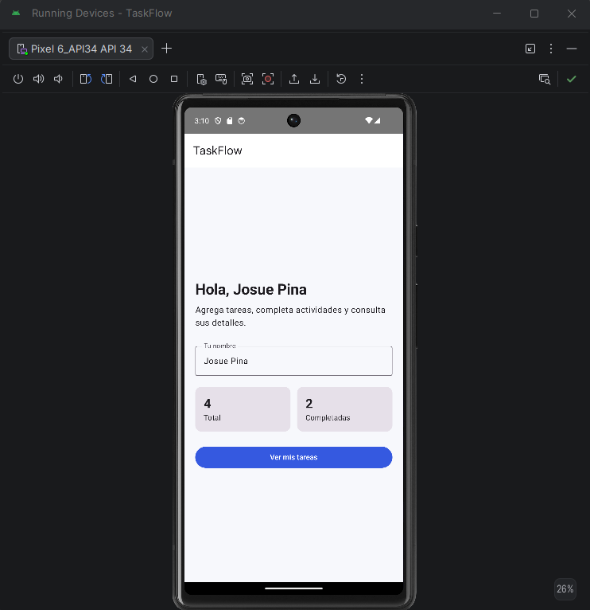
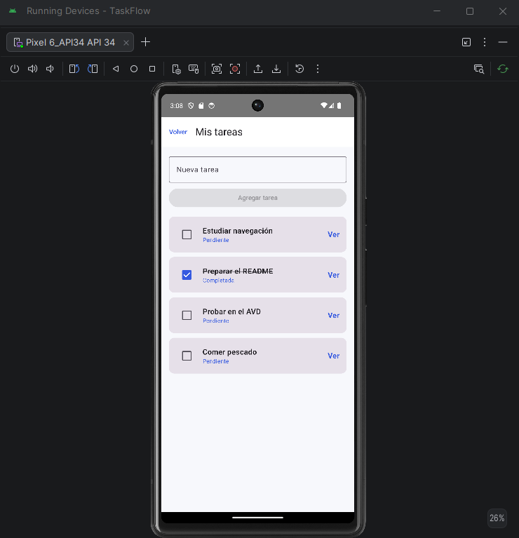
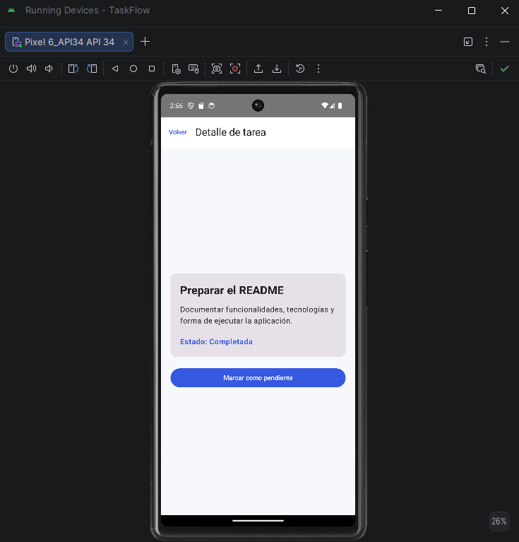

# TaskFlow - Gestor de Tareas Personales

Aplicación Android para la gestión integral de tareas personales, desarrollada con **Kotlin**, **Jetpack Compose**, **Room Database** (con migración manual v1 ➔ v2), **DataStore Preferences** (con migración desde SharedPreferences), **Hilt** y **Material 3 (Teal Theme)**. 

---

## 🏗️ Arquitectura y Estructura del Proyecto

El proyecto está organizado según las recomendaciones de arquitectura de Android y Clean Architecture:

```
app/src/main/java/com/josue/taskflow/
├── TaskFlowApplication.kt            # @HiltAndroidApp
├── MainActivity.kt                   # @AndroidEntryPoint
├── core/                            # Módulos core independientes
│   ├── audio/TaskAudioPlayer.kt     # Adaptador suspendCancellableCoroutine para Android TTS
│   └── collection/ProcessableContainer.kt # Colección genérica, varianza y type bounds
├── data/                            # Capa de Datos (Implementaciones y Mappers)
│   ├── local/
│   │   ├── database/
│   │   │   ├── dao/TaskDao.kt       # Consultas SQL Room
│   │   │   ├── entity/task/TaskEntity.kt # Entidad 'tareas' con created_at (v2)
│   │   │   ├── migration/TaskFlowMigrations.kt # MIGRATION_1_2 manual
│   │   │   └── TaskFlowDatabase.kt # SQLite Room Database (v2, exportSchema = true)
│   │   └── datasource/
│   │       ├── task/TaskLocalDataSource.kt # Fuente local Room
│   │       └── settings/SettingsLocalDataSource.kt # Fuente local DataStore
│   ├── mapper/task/TaskMapper.kt   # Conversión toDomain() / toEntity()
│   └── repository/
│       ├── task/DefaultTaskRepository.kt # Repositorio de tareas
│       └── settings/DefaultSettingsRepository.kt # Repositorio de preferencias
├── di/                              # Módulos de Inyección de Dependencias (Hilt)
│   ├── DatabaseModule.kt            # Proveedor de Room Database y TaskDao
│   ├── DataStoreModule.kt           # Proveedor de DataStore Preferences con SharedPreferencesMigration
│   └── RepositoryModule.kt          # Binding de repositorios
├── domain/                          # Capa de Dominio (Modelos puros y Casos de Uso)
│   ├── model/
│   │   ├── task/Task.kt             # Modelo puro de tarea con createdAt
│   │   ├── task/TaskFilter.kt       # Enum de filtros con decodificación legado/nuevo
│   │   ├── task/TaskOperationResult.kt # Resultados de operaciones
│   │   └── statistics/TaskStatistics.kt # Modelo de estadísticas
│   ├── repository/
│   │   ├── task/TaskRepository.kt   # Contrato de datos de tareas
│   │   └── settings/SettingsRepository.kt # Contrato de preferencias
│   └── usecase/
│       └── task/TaskUseCase.kt      # Caso de uso unificado con las operaciones de tareas
└── ui/                              # Capa de Interfaz de Usuario (Compose UI)
    ├── components/TaskCard.kt       # Componente reutilizable con objetivo >= 48dp
    ├── message/AppMessageHost.kt    # Receptor único de avisos Toast a nivel raíz
    ├── navigation/
    │   ├── AppNavHost.kt            # NavHost principal
    │   └── AppDestination.kt        # Rutas y argumentos de navegación
    ├── screen/
    │   ├── home/                    # Pantalla de Inicio
    │   ├── tasklist/                # Pantalla de Lista de Tareas
    │   └── taskdetail/              # Pantalla de Detalle de Tarea
    └── theme/
        ├── ColorPalette.kt          # Paleta verde azulado Teal Material 3
        ├── TaskFlowTheme.kt         # Temas Claro y Oscuro
        └── Typography.kt            # Tipografía Material 3
```

---

## 📊 Matriz de Cumplimiento y Estado de Prácticas (Laboratorios 0 a 7)

| Práctica | Archivo que la implementa | Estado | Evidencia o verificación realizada |
| :--- | :--- | :--- | :--- |
| **Navegación e Intent Implícito (Lab 0)** | `ui/navigation/AppNavHost.kt`, `ui/screen/taskdetail/view/TaskDetailScreen.kt` | **Completo** | Probado con `NavHost`, argumentos dinámicos y chooser `ACTION_SEND` para compartir tareas. |
| **Genéricos y Funciones de Orden Superior (Lab 1+2)** | `core/collection/ProcessableContainer.kt`, `domain/usecase/task/TaskUseCase.kt` | **Completo** | 12 pruebas unitarias de `ProcessableContainer` pasadas al 100%. |
| **Corrutinas y Callbacks a Suspend (Lab 3)** | `core/audio/TaskAudioPlayer.kt`, `domain/usecase/task/TaskUseCase.kt` | **Completo** | `suspendCancellableCoroutine` sobre Android TextToSpeech y `async`/`await` concurrentes probados. |
| **Flow Reactivo y Operadores (Lab 4)** | `ui/screen/tasklist/viewmodel/TaskListViewModel.kt` | **Completo** | Combinación de Room y DataStore con `combine`, `map`, `retry` y `catch`. Pruebas al 100%. |
| **MVVM y Clean Architecture (Lab 5)** | Capas `ui/`, `domain/`, `data/`, `di/`, `core/` | **Completo** | Inversión de dependencias estricta. El dominio no depende de Android ni Room. |
| **Persistencia Room Database (Lab 6)** | `data/local/database/TaskFlowDatabase.kt`, `data/local/database/dao/TaskDao.kt` | **Completo** | CRUD completo (Crear, Leer, Editar, Eliminar) en Room SQLite verificado con filas afectadas. |
| **Migración Manual de Room (Lab 7)** | `data/local/database/migration/TaskFlowMigrations.kt` | **Completo** | `MIGRATION_1_2` añadiendo columna `created_at INTEGER NOT NULL DEFAULT 0`. Esquemas `1.json` y `2.json` auténticos. |
| **Migración SharedPreferences a DataStore (Lab 7)** | `di/DataStoreModule.kt` | **Completo** | `SharedPreferencesMigration` migra `filtro_tareas_activo` de `taskflow_legacy_preferences` a `user_preferences`. |

---

## 📸 Capturas de Pantalla de la Aplicación

| Pantalla de Inicio (`HomeScreen`) | Pantalla de Lista (`TaskListScreen`) | Pantalla de Detalle (`TaskDetailScreen`) |
| :---: | :---: | :---: |
|  |  |  |

---

## 🛠️ Tecnologías Utilizadas
* **Kotlin 2.x** (Corrutinas, Flow, Genéricos, Varianza, Reified, Scope Functions)
* **Hilt 2.51.1** (Inyección de dependencias)
* **Room Database 2.6.1** (con `MIGRATION_1_2` y `room-testing`) & **KSP**
* **DataStore Preferences 1.1.1** (con `SharedPreferencesMigration`)
* **Clean Architecture & MVVM** (`Route` / `Screen` / `ViewModel` / `UiState`)
* **Jetpack Compose & Material 3 (Teal Theme)**
* **Navigation Compose 2.9.8**
* **JUnit 4** (31 pruebas unitarias e instrumentadas automatizadas)

---

## 🚀 Cómo Ejecutar el Proyecto

1. Clonar el repositorio:
   ```bash
   git clone https://github.com/Josuesolo30/TaskFlow.ProyectoFinalProgMovil1.git
   ```
2. Abrir en **Android Studio**.
3. Sincronizar Gradle.
4. Ejecutar las pruebas unitarias:
   ```bash
   ./gradlew test
   ```
5. Ejecutar la aplicación en el emulador o dispositivo físico.

---

## 📄 Documentación del Lab 7 y Refactorización
* [Documentación de Implementación de Lab 7](docs/LAB7_IMPLEMENTATION.md)
* [Evidencia de Migración y Datos de Lab 7](docs/LAB7_EVIDENCE.md)
* [Reporte Completo de Refactorización y Pruebas](docs/REFACTOR_REPORT.md)
* [Requerimientos de la Aplicación](REQUIREMENTS.md)

---

## 👤 Autor

**Josue Rafael Piña Fermin**  
Estudiante de UNICDA  
Asignatura: Desarrollo Android con Kotlin
