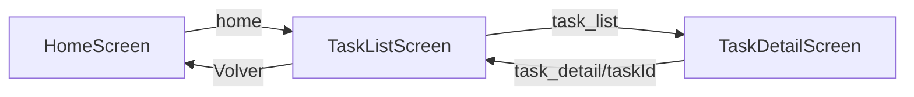
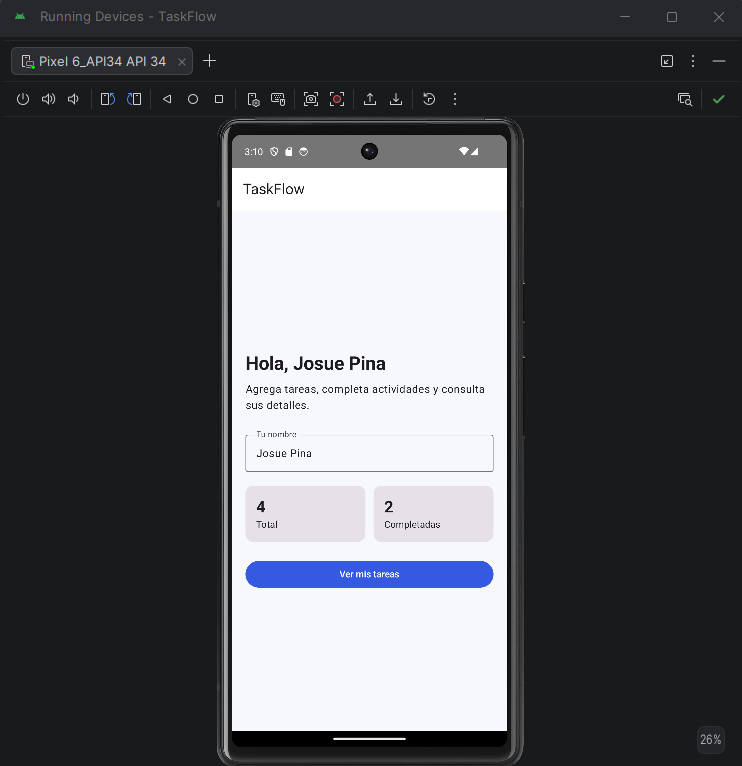
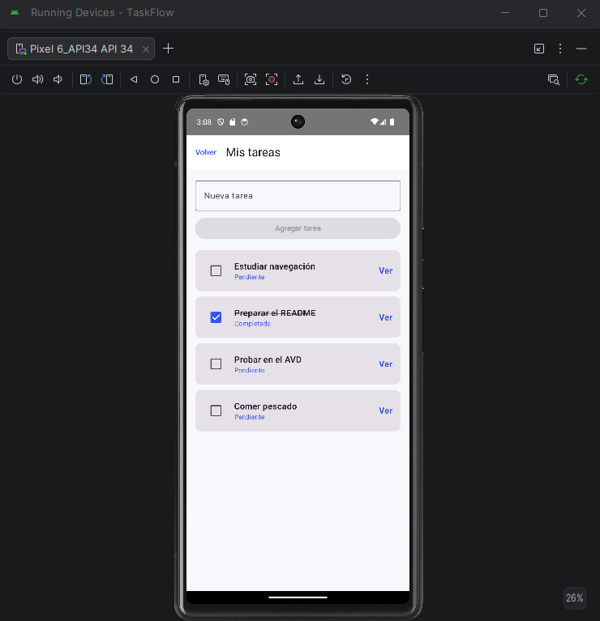
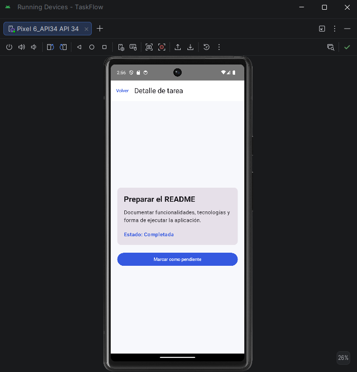

# TaskFlow — Gestor de Tareas Personales (Requirements)

## 1. Descripción
TaskFlow es una aplicación Android desarrollada con Kotlin, Jetpack Compose y Material 3 que permite gestionar tareas personales con almacenamiento persistente en Room Database y DataStore Preferences.

## 2. Requerimientos Funcionales y No Funcionales

### 2.1 Requerimientos Funcionales
* **RF-01**: El usuario podrá ingresar su nombre en la pantalla de inicio (`HomeScreen`).
* **RF-02**: El sistema mostrará una lista desplazable (`TaskListScreen`) de tareas almacenadas localmente.
* **RF-03**: El usuario podrá crear tareas ingresando un título y descripción con validación de campos.
* **RF-04**: El usuario podrá filtrar las tareas por estado: `Todas`, `Pendientes` y `Completadas`, conservando la preferencia en DataStore.
* **RF-05**: El usuario podrá marcar o desmarcar el estado completado de una tarea.
* **RF-06**: El usuario podrá editar la descripción de una tarea existente.
* **RF-07**: El usuario podrá eliminar una tarea con confirmación.
* **RF-08**: El usuario podrá seleccionar una tarea para consultar sus detalles (`TaskDetailScreen`).
* **RF-09**: El usuario podrá compartir la información de una tarea mediante un Intent implícito (`ACTION_SEND`).
* **RF-10**: El usuario podrá escuchar el título y la descripción de una tarea leída en voz alta mediante TextToSpeech (TTS con corrutinas).

### 2.2 Requerimientos No Funcionales
* La interfaz utiliza **Jetpack Compose** y la nueva paleta de colores **Teal Material 3** con soporte para tema claro y oscuro.
* Arquitectura en capas limpia: `presentation`, `domain`, `data`, `di` y `core`.
* Inyección de dependencias con **Hilt** (`@HiltAndroidApp`, `@AndroidEntryPoint`, `@HiltViewModel`).
* Almacenamiento con **Room Database** y **DataStore Preferences**.
* Cobertura de pruebas unitarias automatizadas con JUnit.

## 3. Pantallas de la Aplicación

| # | Nombre de Pantalla | Componentes | Descripción |
|---|---|---|---|
| 1 | `HomeScreen` | `HomeRoute`, `HomeViewModel` | Bienvenida, resumen estadístico (total, pendientes, hechas) y acceso a tareas. |
| 2 | `TaskListScreen` | `TaskListRoute`, `TaskListViewModel` | Lista con chips de filtro, tarjetas `TaskCard`, diálogo de creación y eliminación. |
| 3 | `TaskDetailScreen` | `TaskDetailRoute`, `TaskDetailViewModel` | Detalle, edición de descripción, cambio de estado, lectura por voz (TTS), compartir y borrar. |

## 4. Diagrama de Navegación (`AppNavHost`)

## 5. Capturas de Pantalla de la Aplicación

